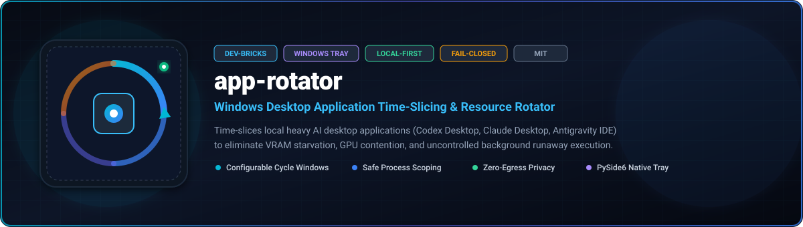
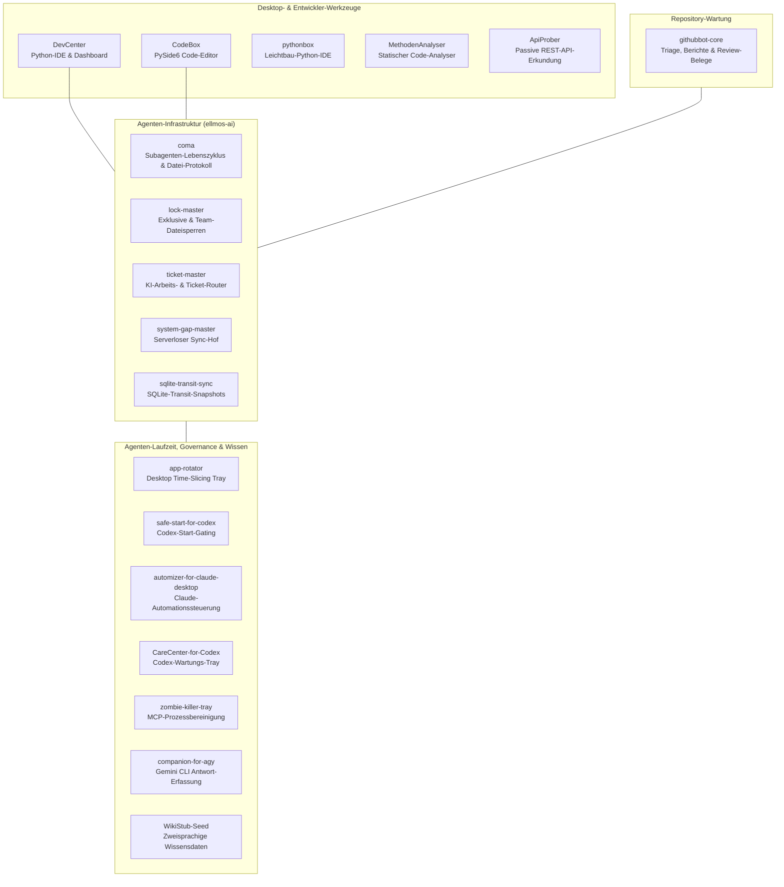

<!-- last-checked: 2026-11-05 -->

  
  
  
  
  
  

# dev-bricks

**Lokale Entwicklerwerkzeuge für Windows, Python, Code-Analyse, API-Erkundung, Desktop-App-Time-Slicing, Repository-Wartung, Subagenten-Lebenszyklus, Codex-Wartung, Gemini-CLI-Integration, Ticket-Routing, Dateisperren, maschinenübergreifenden Agenten-Sync und strukturierte LLM-Kontext-Pipeline-Scaffolding.**

dev-bricks entwickelt kompakte, praktische Software für tägliche Entwicklungsabläufe: Code editieren, Projekte analysieren, eigene APIs dokumentieren, Repositories pflegen, lokale Entwicklerumgebungen übersichtlich halten und KI-Agenten-Ökosysteme verbinden — ohne Abhängigkeit von komplexen Cloud-Plattformen.

> [!NOTE]
> **Öffentlicher Verzeichnisstand:**
> Geprüft am 05.11.2026 anhand der Live-GitHub-Metadaten: 14 aktive Repositories (13 Werkzeug-Repositories + Organisations-Profil-Repository) sowie 1 archiviertes Repository (`fable-5-hunter`) — 15 öffentliche Repositories insgesamt. Private und interne Arbeiten sind in diesem öffentlichen Index bewusst ausgeschlossen.

> [!TIP]
> **Einstiegsempfehlung:**
> Starten Sie mit `CodeBox` oder `pythonbox` für lokale IDE-Arbeit, `ApiProber` oder `MethodenAnalyser` für Projektinspektion, `githubbot-core` für Repository-Wartung und prüfbare Review-Belege, `app-rotator` oder `safe-start-for-codex` für Laufzeitstabilität und Prozess-Time-Slicing, `companion-for-agy` für Gemini-CLI-Integration, `coma` für Subagenten-Prozess- & Datei-Protokoll-Steuerung sowie `lock-master` + `ticket-master` + `system-gap-master` für die Koordination mehrerer KI-Agenten.

## Hier Starten

| Anforderung / Ziel | Projekt | Warum |
|---|---|---|
| Entwickler-Dashboard für lokale Projekte & Build-Pipelines | [DevCenter](https://github.com/dev-bricks/DevCenter) | PySide6-Desktop-Umgebung für Projektübersichten, statische Analyse, PyInstaller-Workflows und optionale KI-Code-Assistenz |
| Desktop-Code-Editor mit LSP-Diagnose & Terminal | [CodeBox](https://github.com/dev-bricks/CodeBox) | PySide6-Editor mit Sprach-Server-Anbindung, Git-Status und integriertem Terminal |
| Leichtbau-Python-IDE mit Debugger & Linting | [pythonbox](https://github.com/dev-bricks/pythonbox) | Schlanke Windows-IDE mit PDB-Debugging, Code-Folding und lokaler Ausführung |
| Passive REST-API-Erkundung für eigene Dienste | [apiprober](https://github.com/dev-bricks/ApiProber) | Werkzeug für API-Inventarisierung, Endpunkt-Dokumentation und OpenAPI-Vorlagen |
| Statische Code-Analyse für Python-Projekte | [MethodenAnalyser](https://github.com/dev-bricks/MethodenAnalyser) | Findet ungenutzte Imports, tote Definitionen, ähnliche Blöcke und liefert JSON-Analysen |
| Issue-Triage, Repository-Berichte & nachprüfbare Review-Belege | [githubbot-core](https://github.com/dev-bricks/githubbot-core) | Neutraler GitHub-Wartungskern ohne Fremdabhängigkeiten: Triage, Duplikaterkennung, Preview/Apply-Aktionen, Plugin-SPI und Review-Belege auf exakten Commit-SHA |
| Strukturierter JSON-Wissensdaten-Stamm für RAG & LLMs | [WikiStub-Seed](https://github.com/dev-bricks/WikiStub-Seed) | Zweisprachiger Wissensstamm mit 630+ DE/EN-Stubs für Forschung, Dokumentation und KI-Kontexte |
| Kontrollierter Start-Gate für Codex Desktop Automationen | [safe-start-for-codex](https://github.com/dev-bricks/safe-start-for-codex) | Pausiert lokale Automationen beim Codex-Start und gibt sie gestaffelt frei |
| Ressourcenintensive Desktop-Apps (Codex, Claude, Antigravity) zeitlich staffeln (Time-Slicing) | [app-rotator](https://github.com/dev-bricks/app-rotator) | Konfigurierbare, Fail-Closed Windows-Tray-App zur zeitlichen Taktung lokaler KI-Anwendungen zur Vermeidung von VRAM- und GPU-Engpässen |
| Aufgaben-Planer & Steuerung für Claude Desktop | [automizer-for-claude-desktop](https://github.com/dev-bricks/automizer-for-claude-desktop) | Zuverlässiges Erstellen und Ändern geplanter Aufgaben für Claude Desktop |
| Lokales Wartungs-Tray & CLI für OpenAI Codex Desktop | [CareCenter-for-Codex](https://github.com/dev-bricks/CareCenter-for-Codex) | Diagnose, Bereinigung, Log-Wartung und Reparatur für Codex Desktop auf Windows |
| Bereinigung verwaister MCP- und Language-Server-Prozesse | [zombie-killer-tray](https://github.com/dev-bricks/zombie-killer-tray) | Konservativer Windows-Tray, der verwaiste MCP-/Language-Server-Prozesse ohne pauschale Prozessbaum-Kills beendet |
| agy / Gemini CLI Antwort-Erfassung im Terminal · [npm](https://www.npmjs.com/package/companion-for-agy) | [companion-for-agy](https://github.com/dev-bricks/companion-for-agy) | Lokales Begleit-CLI & PTY-Wrapper für ANSI-Farbauslesung aus Gemini-CLI-Ausgaben für Claude Code & Codex |
| Modell-Verfügbarkeits-Überwachung für Claude Fable 5 *(archiviert)* | [fable-5-hunter](https://github.com/dev-bricks/fable-5-hunter) | Zero-Dependency-Watcher für die Claude Code CLI zur Erreichbarkeits-Benachrichtigung |
| Standardbibliotheks-Subagenten-Lebenszyklus & Datei-Protokoll (COMAS) | [coma](https://github.com/ellmos-ai/coma) | Null-Abhängigkeiten Python-Schicht für Spawn, Datei-Protokoll-IPC, Status-Polling und Prozessisolierung |
| Triage-Konsole & Ticket-Router für lokale KI-Provider | [ticket-master](https://github.com/ellmos-ai/ticket-master) | Erfasst Fehler und Anfragen als strukturierte Tickets und leitet sie an KI-Agenten weiter |
| Portables Multi-Agenten-Dateisperrsystem | [lock-master](https://github.com/ellmos-ai/lock-master) | Exklusive und Team-Sperren (LOCK*.txt) mit Ablaufzeit, Cloud-Sync-Support und Stale-Cleanup |
| Serverloser Cross-Machine-Sync-Hof für KI-Agenten | [system-gap-master](https://github.com/ellmos-ai/system-gap-master) | Host-Schreibrechte-Regel, tägliches Sync-Ritual, Nachrichten-Kanäle und Bootstrap-Runbook |
| Serverloser SQLite-Datenbank-Abgleich über Devices | [sqlite-transit-sync](https://github.com/ellmos-ai/sqlite-transit-sync) | SQLite-Sync via verifizierten Transit-Snapshots und Zeilen-Merge-Policen ohne Datenbank-Server |

## Repository-Verzeichnis

### dev-bricks Werkzeuge & Profil

| Repository | Rolle | Status |
|---|---|---|
| [DevCenter](https://github.com/dev-bricks/DevCenter) | Lokale Python-IDE und Entwickler-Toolkit mit Dashboards, statischer Analyse und PyInstaller-Workflows | Aktiv |
| [CodeBox](https://github.com/dev-bricks/CodeBox) | PySide6 Desktop-Code-Editor mit LSP-Diagnose, Terminal, Projektnavigation, Git-Anbindung und Oberfläche in 6 Sprachen (DE, EN, ES, ZH, JA, RU) | Aktiv |
| [pythonbox](https://github.com/dev-bricks/pythonbox) | Schlanke Windows-Python-IDE mit PDB-Debugging, Linting, Code-Folding und lokaler Ausführung | Aktiv |
| [apiprober](https://github.com/dev-bricks/ApiProber) | Passiver REST-API-Scout, Endpunkt-Inventar und OpenAPI-orientierte Dokumentation für berechtigte Dienste | Aktiv |
| [MethodenAnalyser](https://github.com/dev-bricks/MethodenAnalyser) | Statischer Python-Analysator für tote Definitionen, ungenutzte Imports und AST-Strukturen | Aktiv |
| [githubbot-core](https://github.com/dev-bricks/githubbot-core) | Neutraler GitHub-Wartungskern (Python, nur Standardbibliothek): Issue-Triage, Repository-Berichte, Preview/Apply-Aktionen, Plugin-SPI und Review-Belege auf exakten Commit-SHA | Aktiv |
| [WikiStub-Seed](https://github.com/dev-bricks/WikiStub-Seed) | Zweisprachiger JSON-Wissensrahmen mit 630+ DE/EN-Stubs für KI-Forschung, Dokumentation und RAG-Pipelines | Aktiv |
| [safe-start-for-codex](https://github.com/dev-bricks/safe-start-for-codex) | Start-Gate für Codex-Desktop-Automationen zur Vermeidung von Lastspitzen beim Systemstart | Aktiv |
| [app-rotator](https://github.com/dev-bricks/app-rotator) | Konfigurierbare Windows-Tray-App zur zeitlichen Staffelung (Time-Slicing) ressourcenintensiver Desktop-KI-Apps zur Vermeidung von VRAM-/GPU-Engpässen | Aktiv |
| [automizer-for-claude-desktop](https://github.com/dev-bricks/automizer-for-claude-desktop) | Werkzeug für das Steuern und Ändern geplanter Claude Desktop Aufgaben | Aktiv |
| [CareCenter-for-Codex](https://github.com/dev-bricks/CareCenter-for-Codex) | Windows-Tray und CLI für Reparatur, Diagnose und Log-Bereinigung von OpenAI Codex Desktop | Aktiv |
| [zombie-killer-tray](https://github.com/dev-bricks/zombie-killer-tray) | Konservativer Windows-Tray zur Bereinigung ausgewählter verwaister MCP- und Language-Server-Prozesse einzeln, ohne pauschale Prozessbaum-Beendigung | Aktiv |
| [companion-for-agy](https://github.com/dev-bricks/companion-for-agy) | Lokales Begleit-CLI & PTY-Wrapper für agy (Gemini CLI) zur programmierten Terminal-Antwort-Erfassung via ANSI-Farbauslesung · [npm](https://www.npmjs.com/package/companion-for-agy) | Aktiv |
| [fable-5-hunter](https://github.com/dev-bricks/fable-5-hunter) | Benachrichtigungs-Watcher für die Erreichbarkeit von Claude Fable 5 in Claude Code *(archiviert)* | Archiviert |
| [.github](https://github.com/dev-bricks/.github) | Organisationsprofil, Vorlagen für Issues/PRs, Community-Workflows und maschinenlesbarer Index | Aktiv |

## Aktuelle Öffentliche Aktivität

| Repository | Letzter öffentlicher Push | Fokus |
|---|---:|---|
| [.github](https://github.com/dev-bricks/.github) | 2026-11-05 | Organisationsprofil und öffentliche Verzeichnisparität |
| [app-rotator](https://github.com/dev-bricks/app-rotator) | 2026-11-04 | Desktop-App-Time-Slicing und VRAM-Governance |
| [MethodenAnalyser](https://github.com/dev-bricks/MethodenAnalyser) | 2026-11-04 | Statische Python-Code-Analyse für ungenutzte Imports und tote Definitionen |
| [zombie-killer-tray](https://github.com/dev-bricks/zombie-killer-tray) | 2026-11-03 | Bereinigung ausgewählter verwaister MCP-/Language-Server-Prozesse |
| [ApiProber](https://github.com/dev-bricks/ApiProber) | 2026-11-03 | Autorisiertes API-Inventar und OpenAPI-Erkundung |
| [DevCenter](https://github.com/dev-bricks/DevCenter) | 2026-11-03 | Lokales Entwickler-Dashboard und IDE |
| [CodeBox](https://github.com/dev-bricks/CodeBox) | 2026-11-02 | PySide6 Desktop-Code-Editor mit LSP und Terminal |
| [CareCenter-for-Codex](https://github.com/dev-bricks/CareCenter-for-Codex) | 2026-11-02 | Reparatur und Diagnose für Codex Desktop |
| [safe-start-for-codex](https://github.com/dev-bricks/safe-start-for-codex) | 2026-11-02 | Start-Gate für Codex Desktop Automationen |
| [WikiStub-Seed](https://github.com/dev-bricks/WikiStub-Seed) | 2026-11-02 | Strukturierte JSON/Markdown-Wissensstubs |
| [githubbot-core](https://github.com/dev-bricks/githubbot-core) | 2026-11-02 | Neutrale GitHub-Wartung, Triage und Review-Belege |
| [automizer-for-claude-desktop](https://github.com/dev-bricks/automizer-for-claude-desktop) | 2026-10-16 | Claude-Desktop-Aufgaben-Automation |
| [pythonbox](https://github.com/dev-bricks/pythonbox) | 2026-09-22 | Leichtbau-Python-IDE |
| [companion-for-agy](https://github.com/dev-bricks/companion-for-agy) | 2026-09-16 | Antigravity / Gemini CLI Begleit-CLI & Terminal-Antwort-Erfassung |
| [fable-5-hunter](https://github.com/dev-bricks/fable-5-hunter) *(archiviert)* | 2026-06-25 | Benachrichtigungs-Watcher für Claude Fable 5 |

**Momentaufnahme:** Alle Zeilen stammen aus einer einzigen Live-Abfrage der GitHub-API vom 05.11.2026; die `.github`-Zeile spiegelt diese Profilaktualisierung wider.

### Integrierte ellmos-ai Infrastruktur

| Repository | Rolle | Status |
|---|---|---|
| [coma](https://github.com/ellmos-ai/coma) | Communication for Autonomous Subagents (COMAS): Null-Abhängigkeiten Lebenszyklus-, Datei-Protokoll- & Status-Polling-Schicht | Aktiv |
| [ticket-master](https://github.com/ellmos-ai/ticket-master) | Triage-Konsole und Ticket-Router zur Verteilung von Aufgaben an Claude, Codex, Gemini oder Subagenten | Aktiv |
| [lock-master](https://github.com/ellmos-ai/lock-master) | Portables Dateisperrsystem für Multi-Agenten-Setups mit Exklusiv- & Team-Locks | Aktiv |
| [system-gap-master](https://github.com/ellmos-ai/system-gap-master) | Serverloser Sync-Hof (sync-master) für mehrere Maschinen und KI-Agenten mit daily sync ritual und Bootstrap-Runbook | Aktiv |
| [sqlite-transit-sync](https://github.com/ellmos-ai/sqlite-transit-sync) | SQLite-Datenbank-Sync über Transit-Snapshots und Zeilen-Merge-Regeln ohne Server | Aktiv |

## Werkzeug-Präsentation (Showcase)

Die Banner dienen als Direktlinks; Details finden sich in den Tabellen oben und unten:

  
  
  
  
  
  
  
  
  
  
  
  

## Projekt-Familien

| Familie | Repositories | Schwerpunkt |
|---|---|---|
| Desktop-IDEs | [DevCenter](https://github.com/dev-bricks/DevCenter), [CodeBox](https://github.com/dev-bricks/CodeBox), [pythonbox](https://github.com/dev-bricks/pythonbox) | Lokale PySide6-Entwickleroberflächen für Code-Bearbeitung, Debugging, Projektnavigation und Build-Workflows |
| Analyse & Erkundung | [MethodenAnalyser](https://github.com/dev-bricks/MethodenAnalyser), [apiprober](https://github.com/dev-bricks/ApiProber) | Statische Code-Inspektion und passive API-Dokumentation für berechtigte Systeme |
| Repository-Wartung | [githubbot-core](https://github.com/dev-bricks/githubbot-core) | Neutraler GitHub-Wartungskern ohne Fremdabhängigkeiten: Issue-Triage, Duplikaterkennung, Repository-Berichte, Preview/Apply-Aktionen, Plugin-SPI und Review-Belege auf exakten Commit-SHA |
| Agenten-Tools & Support | [safe-start-for-codex](https://github.com/dev-bricks/safe-start-for-codex), [app-rotator](https://github.com/dev-bricks/app-rotator), [automizer-for-claude-desktop](https://github.com/dev-bricks/automizer-for-claude-desktop), [CareCenter-for-Codex](https://github.com/dev-bricks/CareCenter-for-Codex), [zombie-killer-tray](https://github.com/dev-bricks/zombie-killer-tray), [companion-for-agy](https://github.com/dev-bricks/companion-for-agy), [fable-5-hunter](https://github.com/dev-bricks/fable-5-hunter) *(archiviert)* | Codex-Start-Gating, Desktop-App-Time-Slicing, Claude-Desktop-Steuerung, Codex-Reparatur, verwaiste MCP-/Language-Server-Prozesshygiene, Gemini-CLI-Antworterfassung und Modell-Monitoring (archiviert) |
| Wissens-Frameworks | [WikiStub-Seed](https://github.com/dev-bricks/WikiStub-Seed) | Strukturierte JSON/Markdown-Stammdaten für Dokumentations-Glossare, RAG und LLM-Pipelines |
| Agenten-Infrastruktur | [coma](https://github.com/ellmos-ai/coma), [lock-master](https://github.com/ellmos-ai/lock-master), [ticket-master](https://github.com/ellmos-ai/ticket-master), [system-gap-master](https://github.com/ellmos-ai/system-gap-master), [sqlite-transit-sync](https://github.com/ellmos-ai/sqlite-transit-sync) | Die Koordinations- & Lebenszyklus-Schicht für Multi-Agenten-Teams: Subagenten-Steuerung & Datei-Protokoll, Dateisperren, Ticket-Routing und serverloser Datei- und DB-Sync |

## Systemarchitektur

## Entwurfsprinzipien

- **Lokal zuerst (Local First):** Werkzeuge sind für die lokale Ausführung konzipiert; Datenspeicherung und Netzwerkverhalten sind pro Repository transparent dokumentiert.
- **Spezifische Werkzeuge statt monolithischer Plattformen:** Jedes Projekt adressiert einen konkreten Arbeitsschritt im Alltag.
- **Windows-Pragmatismus:** Desktop-Anwendungen setzen auf zuverlässige Ausführung, geringe Einstiegshürden und saubere Systemintegration.
- **Klare Grenzen:** Sicherheitsrelevante Werkzeuge (wie API-Erkundung) sind ausschließlich für eigene oder autorisierte Systeme dokumentiert.
- **Verständliche Automation:** Skripte, Tests und Exporte sind für Menschen und LLM-gestützte Pflege gleichermaßen transparent gestaltet.

## Suche & Auffindbarkeit

Bewährte Suchbegriffe zum Auffinden von dev-bricks Projekten auf GitHub und externen Suchmaschinen:

- dev-bricks lokale Entwicklerwerkzeuge
- dev-bricks Python IDE und PySide6 Code-Editor
- dev-bricks coma Subagenten-Lebenszyklus
- dev-bricks coma communication for autonomous subagents
- dev-bricks Subagenten Datei-Protokoll Status-Polling
- dev-bricks statische Code-Analyse Python
- dev-bricks passive REST-API-Erkundung und OpenAPI-Inventar
- dev-bricks githubbot-core GitHub Wartungskern
- dev-bricks Python Standardbibliothek Issue-Triage CLI
- dev-bricks Repository-Berichte und Duplikaterkennung
- dev-bricks prüfbare Code-Review-Belege Commit-SHA
- dev-bricks Preview und Apply Dry-Run GitHub-Aktionen
- dev-bricks app-rotator Desktop-Time-Slicing
- dev-bricks VRAM-Management lokale KI-Desktop-Apps
- dev-bricks Windows Tray App Ressourcen-Staffelung
- dev-bricks Codex Claude Antigravity Time-Slicing
- dev-bricks Fail-Closed Desktop App-Rotator
- dev-bricks Codex Desktop Wartung und Reparatur
- dev-bricks zombie killer verwaiste MCP-Prozess-Bereinigung
- dev-bricks sichere Windows Prozessbereinigung
- dev-bricks Safe Start für Codex
- dev-bricks Codex Automationen Start-Gate
- dev-bricks automizer für Claude Desktop
- dev-bricks Claude Desktop geplante Aufgaben steuern
- dev-bricks companion for agy Gemini CLI Wrapper
- dev-bricks Claude Fable 5 Erreichbarkeits-Watcher
- dev-bricks ticket-master KI-Ticket-Routing
- dev-bricks lokales KI-Aufgaben-Routing
- dev-bricks Multi-Agenten-Orchestrierung
- dev-bricks lock-master Dateisperren für KI-Agenten
- dev-bricks system-gap-master serverloser Sync-Hof
- dev-bricks sync-master maschinenübergreifender Agenten-Sync
- dev-bricks sqlite-transit-sync serverloser SQLite-Sync
- dev-bricks SQLite-Transit-Snapshots Zeilen-Merge
- dev-bricks serverloser Sync-Hof für KI-Agenten
- dev-bricks Cross-Agenten-Infrastruktur Lock Ticket Sync
- dev-bricks WikiStub-Seed JSON-Wissensrahmen
- dev-bricks zweisprachige Wissensstubs
- dev-bricks LLM-Wissensbasis Seed
- dev-bricks Ontologie-Starter-Datensatz
- dev-bricks Windows Entwickler-Tools

## Maschinenlesbarer Kontext

Für Crawler, LLM-Tools und automatisierte Agenten steht [`llms.txt`](https://github.com/dev-bricks/.github/blob/main/llms.txt) bereit. Die Datei enthält die kanonischen Repositories, Rollenbeschreibungen und bevorzugten Suchbegriffe der dev-bricks Organisation.

## Ökosystem

dev-bricks ist die Entwickler-Sparte der Bricks-Produktlinie:

[open-bricks](https://github.com/open-bricks) — [file-bricks](https://github.com/file-bricks) — [doc-bricks](https://github.com/doc-bricks)

Teil des [ellmos-ai](https://github.com/ellmos-ai) Ökosystems.

<!-- last-checked: 2026-11-05 -->
